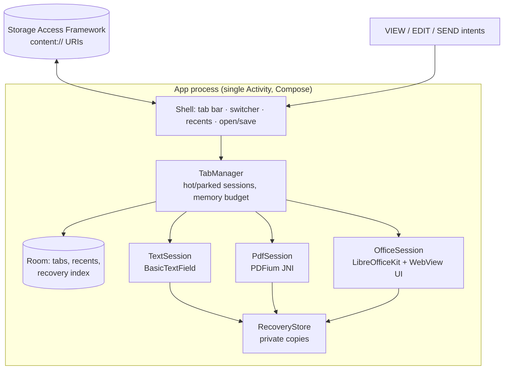
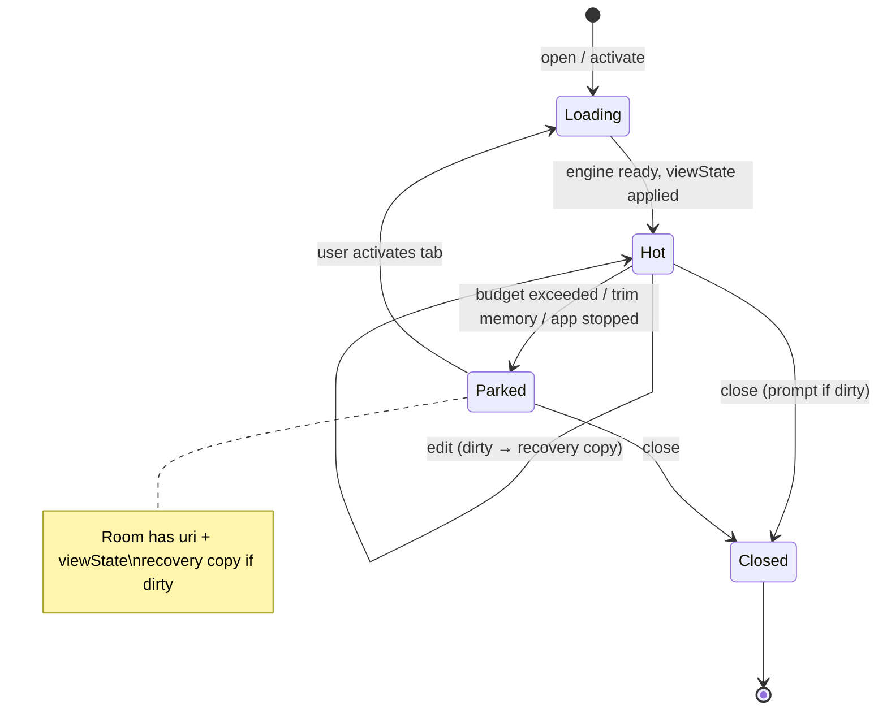

# Architecture proposal

**Status: APPROVED 2026-10-31**, with the decisions recorded in §9. Build has started at M0.

Name: **Libreon** ("Work freely"); "Offline Office" was the working name. Kotlin + Jetpack Compose, single-activity, fully offline, zero runtime permissions.

## 0. Summary of decisions

| Area | Recommendation | Main alternative |
|---|---|---|
| Office formats (docx/xlsx/pptx) | **LibreOfficeKit (LibreOffice core, as used by Collabora Office for Android), MPL-2.0**, driven through the Collabora Online JS front-end in a local, network-blocked WebView | Apache POI "safe edit" mode (contingency, see 1.3) |
| PDF | **PDFium** (prebuilt `pdfium-binaries`, BSD/Apache) + **our own JNI**: render, text, AcroForm fill, image and ink stamping, save-as-copy | `androidx.pdf` 1.0.0-beta01 (`EditablePdfViewerFragment`) |
| Text / Markdown | Compose `BasicTextField` + `TextFieldState`; **commonmark-java** (BSD-2) → HTML in a no-JS WebView for preview | Markwon (Apache-2.0, unmaintained) |
| Tabs | In-app tab registry (Room) with **hot and parked sessions** under a memory budget, plus recovery copies | MS/WPS-style slot activities in separate processes (rejected) |
| Storage | **SAF only**, persistable grants, private working copies for transient grants | — |
| Permissions | **None.** INTERNET is explicitly removed from the merged manifest. | — |
| SDK | minSdk **31** (Android 12), target/compile **36**, ABIs arm64-v8a + x86_64 (emulator) | — |
| License | **GPL-3.0-or-later** for our own code | — |

---

## 1. Office formats

### 1.1 Options compared

| | **A. LibreOfficeKit / Collabora Office** | **B. ONLYOFFICE** | **C. Apache POI + own renderer** |
|---|---|---|---|
| What it is | LibreOffice core cross-compiled for Android. Collabora's Android app hosts the Collabora Online JS editor in a WebView, talking to the in-process core over a local message bridge with no real socket. | sdkjs + web-apps editors (JS) + `x2t` native converter | Java parse/write library. We write all rendering and editing UI. |
| Render fidelity | Good for docx/xlsx/pptx and ODF, the same as LibreOffice desktop. Weaker on complex OOXML (SmartArt, some charts and animations). | Very good on OOXML (it is OOXML-native) | Low. We would hand-build layout. A docx→HTML preview is feasible, true page layout is not. |
| Edit and save in original format | Yes, all three, through the same filters as LibreOffice | Yes | Text-level edits only (paragraph text, cell values, shape text). Unknown parts round-trip well because POI keeps the XML parts. |
| License | **MPL-2.0** (file-level copyleft) + bundled MIT/BSD/LGPL deps | **AGPL-3.0** for the editors. The whole app would have to be AGPL-3.0. We could not confirm a buildable open Android editor module. | Apache-2.0 |
| APK size (arm64) | About 40 MB per ABI. Observed: Collabora Office 26.04.4.2 split APK is 40.1 MB, minSdk 32. | Large (JS editors + x2t, est. 60–100 MB) | Small (POI ooxml-lite + XMLBeans, est. 10–15 MB after R8) |
| Build complexity | **High.** Cross-compiling LibreOffice core needs a Linux host (WSL2 here), tens of GB of disk and hours per ABI, plus the Collabora `online` repo for the JS front-end and Android glue. | High and poorly documented for Android | Low to medium |
| Memory | Heavy, about 150–400 MB per open document | Heavy (WebView + JS model) | Light to medium |
| Offline | Yes. The front-end is local assets. We block every network request. | Yes | Yes |

### 1.2 Recommendation: A (LibreOfficeKit), with C as the contingency

LibreOfficeKit is the only open-source option that **views, edits and saves all three OOXML formats with real fidelity under a non-viral license**. ONLYOFFICE has better OOXML fidelity, but AGPL-3.0 would force the whole app to AGPL. Choose it only if you are happy to open-source the app under AGPL. POI cannot meet "open, basic edit, save without data loss" with acceptable visual fidelity on its own.

How we integrate it:

- **Engine.** Build LibreOffice core (`--with-distro=CPAndroid`-style config, as in Collabora's Android build) for arm64-v8a and x86_64. The result is one merged native library plus resources and fonts. Built in WSL2. The existing Ubuntu 20.04 distro is probably too old, so plan a 24.04 distro.
- **UI.** Reuse the Collabora Online browser front-end (MPL-2.0) as the editor UI inside an `OfficeSession` WebView:
  - assets load from `https://appassets.androidplatform.net/` via `WebViewAssetLoader`
  - JavaScript ↔ native through a `WebMessagePort` bridge we write
  - every other request is rejected in `shouldInterceptRequest`

  We write our own Kotlin/C++ glue. Collabora's Android code is a reference, not a source to copy. If we do reuse any MPL file, it stays MPL with its notices and its source is published.
- **Our shell around it.** The tab bar, open and save, recents and recovery stay native Compose. The WebView fills the document area. We strip online-only front-end features: share, comments-with-identity, sign-in and help links.
- **Save.** LOK `saveAs` to a private temp file in the original filter (docx/xlsx/pptx), then stream that to the SAF URI (see §5). Never write the destination in place until the temp save succeeds.

### 1.3 Contingency (if M0 shows LOK cannot be built or shipped)

Fall back to **C, a "safe edit" mode on Apache POI**:

- **docx**: an HTML preview, editing at paragraph level.
- **xlsx**: a grid with cell values and formulas, recalculated by POI's evaluator.
- **pptx**: per-shape text editing over a rasterised slide.

Write back with POI. This keeps unknown parts intact, but the visual fidelity is clearly below the acceptance bar. You would need to accept a lower bar for M4.

### 1.4 Office risks

- **Build risk.** This is the biggest risk in the project. M0 time-boxes it before anything depends on it.
- **One live document at a time.** Collabora's Android glue is built around a single document per process. We plan **one hot Office session** and park the others (§4). Switching to a parked Office tab takes about 1–3 s to reload, and restores page and scroll position, not undo history.
- **Duplicate PDFium symbols.** LibreOffice also links PDFium for its PDF import. If its merged library exports PDFium symbols, they clash with our PDFium. Mitigations, in order: build LOK without PDFium (`--disable-pdfium`), or use symbol-visibility and namespace isolation (separate `dlopen` with `RTLD_LOCAL`).
- **In-process crash.** An engine crash kills the app. Mitigation: frequent recovery copies (§4.4). Moving LOK to a separate `:office` process is a later option, not v1.

---

## 2. PDF

### 2.1 Options compared

| | **PDFium + own JNI** | `androidx.pdf` 1.0.0-beta01 | Platform `PdfRenderer` | pdf.js in WebView | MuPDF |
|---|---|---|---|---|---|
| Render quality and speed | Excellent. Chrome's engine, which **both reference apps use**. | Good (PDFium underneath) | Good, render only | OK; slower on large files | Excellent |
| AcroForm fill | Yes, through the form-fill environment | Yes (text, dropdown, checkbox, radio) | API 35+ only | Yes | Yes |
| Add image/ink signature | Yes (image page objects, ink paths, or stamp annotations) | Ink only. Image stamps are not documented. | No | Ink and stamp editors | Yes |
| Save | `FPDF_SaveAsCopy` (incremental or full) | `PdfWriteHandle` | API 35+ only | `saveDocument()` | Yes |
| License | BSD-3 / Apache-2.0 (+ FreeType FTL, libjpeg-turbo, OpenJPEG, lcms2, zlib) | Apache-2.0 | Platform | Apache-2.0 | **AGPL-3.0** or commercial |
| Maturity | Stable C API. Our JNI is new code (about 1.5k lines). | **Beta**, API still moving | Stable | Stable | Stable |
| minSdk | Any | 28 | 21 / 35 for edits | Any (WebView) | Any |

### 2.2 Recommendation: PDFium with our own JNI

One engine for view, fill, sign and save, matching what MS and WPS ship. The plan:

- **Rendering.** Tile-based rendering into `Bitmap`s at the current zoom, in a Compose `LazyColumn` page list with pinch-zoom. A low-res full-page pass first, then high-res tiles. An LRU bitmap cache bounded by the memory budget. Text extraction for search and selection.
- **Form filling.** Initialise the PDFium form-fill environment per document. We overlay a native Compose `TextField` positioned over the focused widget's rectangle, and write the value into the field on commit (the same approach as MS). Checkboxes and radios toggle on tap, and choice fields show a Compose dropdown. Field values are written as **real AcroForm values with regenerated appearance streams**, so other viewers show them.
- **Flat forms (no fields).** A "Fill" tool free-places text, ✓ and ✗ marks (the WPS pattern). These are committed as FreeText or stamp annotations, and flattened on export if the user asks.
- **Signature capture.** A Compose canvas with pressure-insensitive smoothed strokes, Clear and Done buttons, a colour choice (black or blue), and *Import image* (Android Photo Picker, no permission needed). Strokes are stored as **vector paths** (our own small JSON format) plus a rendered PNG. Several saved signatures and initials are kept in app-private storage. Nothing leaves the device.
- **Signature placement.** Tap *Sign*, pick a signature, and a resizable, movable box appears on the page; commit with Done. Committing writes a **stamp annotation with an appearance stream holding the image**. With *Flatten on save* (default **on** for signatures, mirroring WPS) the stamp is merged into the page content.
- **Save.** Always **"Save as new file"** by default (SAF `CREATE_DOCUMENT`, suggested name `name (signed).pdf`). Overwriting the original is optional. Save uses `FPDF_SaveAsCopy`, incremental when not flattening, so the original bytes stay untouched.
- **If PDFium appearance generation is insufficient** for some field types, add **PdfBox-Android** (Apache-2.0, `com.tom-roush:pdfbox-android` 2.0.27.0) only as a post-processing writer. It is not in the v1 dependency set.

Re-evaluate `androidx.pdf` at 1.0 stable. It could replace our renderer later, but it doesn't document image stamping yet and is still beta.

### 2.3 PDF risks

- Our JNI is new native code, so crashes would be ours. Mitigations: fuzz against the test set, keep all PDFium calls on one dedicated thread per document (PDFium is not thread-safe), and handle native failures defensively.
- XFA forms are not supported, matching both references. We'll show a notice.
- Encrypted PDFs need a password prompt (PDFium supports this).

---

## 3. Plaintext and Markdown

- **File types**: `.txt`, `.md`/`.markdown`, `.csv`/`.tsv`, `.json`, `.xml`, `.log`, `.ini`/`.cfg`/`.conf`, `.yaml`/`.yml`, plus any `text/*`.
- **Editor**: Compose `BasicTextField` with the state-based `TextFieldState` API, which has built-in undo and redo and copes better with large text than the value/onValueChange API.
  - Monospace toggle, word wrap toggle, find and replace, go to line, character and line count.
- **Large files**: up to 2 MB open editable. Between 2 and 50 MB open **read-only** in a virtualised line list (`LazyColumn` over a line index built by streaming). Above 50 MB we show a warning and offer read-only head and tail.
- **Encoding**: BOM first, then strict UTF-8, then a small built-in heuristic (UTF-16 without BOM, East Asian multibyte, windows-1252, ISO-8859-1). ICU's `CharsetDetector` is not part of the public Android SDK, so it cannot be used. Remember the encoding, BOM and line-ending style per tab, and write them back the same way, so no unintended conversions happen.
- **Markdown preview**: a split, toggle or swipe between Edit and Preview. Rendering is `commonmark-java` + GFM tables, strikethrough and task-list extensions → HTML, shown in a WebView with **JavaScript disabled, file and content access disabled, and all network loads blocked**. Light and dark CSS is our own.
- **CSV**: a "Table view" toggle (our own RFC 4180 parser) as a read-only grid. Editing happens in text mode. An *Open as spreadsheet* action hands the file to the Office engine.
- **JSON**: a *Format* action (pretty-print and validate, using `org.json` from the platform).

---

## 4. Tabs

### 4.1 Model

A single activity with an **in-app tab registry**. We deliberately do *not* use per-document processes or tasks (the MS/WPS slot pattern): it costs a lot of memory and complexity, and the brief asks for an in-app tab model.

`TabRecord` (Room table), modelled on what WPS persists:

- id, `uri`, display name, kind (`TEXT | MARKDOWN | PDF | DOCX | XLSX | PPTX | …`), MIME
- grant type: `PERSISTED | TRANSIENT | PRIVATE_COPY` (see §5)
- `openedAt`, `lastActiveAt`, order index
- `viewState`: a small JSON blob per kind (scroll offset, cursor and selection, page and zoom, sheet and active cell, slide index)
- `dirty` flag, `recoveryPath`, `recoveryUpdatedAt`
- `sourceFingerprint` (size + last-modified from the provider), to detect external changes

A **closed-tabs list** (last 20) supports "Reopen closed tab".

### 4.2 UI

- **Phones**: a compact top bar with the current document, a tab-count chip that opens a **switcher sheet** (cards with type icon, name, unsaved dot, close button; reorder by drag), and swipe on the chip to change tabs.
- **Tablets and foldables** (width ≥ 600 dp): a scrollable **tab strip**.
- **Re-opening** a file that is already open focuses its tab instead of opening a duplicate (the MS rule).

### 4.3 Hot and parked sessions (memory)

- A `TabManager` keeps **live engine sessions** under a budget derived from `ActivityManager.memoryClass` / `largeMemoryClass` (`largeHeap` on):

  | Kind | Live sessions |
  |---|---|
  | Office | 1 (the LOK constraint, §1.4) |
  | PDF | up to 3 |
  | Text | unlimited (only buffers ≤ 2 MB) |

- When a budget is exceeded, the **least recently used non-visible session is parked**: if dirty, it writes a recovery copy, saves its `viewState`, and frees its engine resources. The tab stays in the bar.
- Activating a parked tab reloads it from the recovery copy (or the source if clean) and restores `viewState`, showing a placeholder thumbnail while it loads.
- `onTrimMemory(RUNNING_LOW / UI_HIDDEN)` parks more aggressively.
- This meets **"≥ 5 documents open with no state lost on switching"**. The cost is that an Office or PDF tab may reload, at most a few seconds for typical files.

### 4.4 Surviving process death and crashes

- The tab registry and `viewState` live in Room and are updated on every tab switch and in `onStop`.
- **Recovery copies**:
  - **Text** writes after 2 s of idle.
  - **PDF**: we keep pending form values and annotations as our own edit log and replay it.
  - **Office**: LOK `saveAs` to private storage every 60 s while dirty, plus on tab switch and `onStop`.
- On cold start the app restores the tab bar and loads only the active tab. If a recovery copy is newer than the source, a banner offers **Restore unsaved changes / Discard**.
- A tab whose URI grant was transient and is now gone opens from its private copy. *Save* then becomes *Save as…* (§5).

---

## 5. Storage (SAF only)

- **No storage permissions at all.** Files come only from:
  1. **Open** (`ACTION_OPEN_DOCUMENT` with our MIME list, multi-select allowed)
  2. **Open with / share**: `VIEW`, `EDIT` and `SEND` intent filters for our MIME types, `content:` scheme only. There is an extension fallback filter for `application/octet-stream`, as MS does (findings 1.1).
  3. **New** (`ACTION_CREATE_DOCUMENT`)
- **Grants**:
  - For picker results we call `takePersistableUriPermission`, so the tab and recents entry can be reopened later (`PERSISTED`).
  - For `VIEW` / `SEND` intents the grant is usually temporary. While it is valid we copy the file into app-private storage. Edits go to that copy, and *Save* writes back to the original URI while the grant lasts (`TRANSIENT`). After process death the grant is gone, so the tab works on the copy and *Save* turns into *Save as…* (`PRIVATE_COPY`).
- **Safe write**: write to a private temp file → `fsync` → open the target with mode `"wt"` → stream-copy → verify the byte count → drop the temp. If the target write fails, the temp file is kept and offered as *Save as…*.
- **External change detection**: before saving, compare the provider's size and last-modified with `sourceFingerprint`. If they differ, ask Overwrite / Save as copy.
- **Recents**: a Room table (uri, name, kind, size, lastOpened, pinned, thumbnail path in private cache). Only entries with a persisted grant can be reopened; the rest show as "re-pick to open". *Clear recents* releases persisted grants. No content indexing, no telemetry.
- **Signatures and settings**: app-private files and DataStore. Backups are excluded with `allowBackup=false` and data-extraction rules, so signatures don't go to cloud backup.

---

## 6. Platform, permissions, build

- **Permissions**: none declared. The merged manifest explicitly removes INTERNET (`tools:node="remove"`), and a CI check fails the build if any `uses-permission` appears in the merged manifest. Other settings:
  - `usesCleartextTraffic=false`
  - a network-security config that denies everything
  - WebViews refuse non-asset URLs
- **No analytics, crash reporting, ads, Play Services or Firebase.** Gradle dependency verification and a dependency allowlist enforce this.
- **SDK**:
  - minSdk 31 (Android 12). Collabora currently ships minSdk 32; if LOK turns out to need 32 we follow.
  - target and compile SDK 36 (installed). Bump when a newer platform is stable.
- **Language and UI**: Kotlin 2.x, Jetpack Compose (Material 3), Coroutines, Room, DataStore, `WebViewAssetLoader`. NDK 28 (installed) for the PDFium JNI and LOK glue.
- **ABIs**: arm64-v8a (devices) and x86_64 (emulator), shipped as per-ABI splits.
- **Expected size**: about 40 MB LOK + about 6 MB PDFium + about 5 MB app ≈ **50–55 MB per ABI**.
- **Build hosts**: the Android app builds on Windows. The LOK native build runs in WSL2 (Ubuntu 24.04) and produces a prebuilt AAR that the app consumes, so app developers don't rebuild LibreOffice.
- **Licensing**: our own code is **GPL-3.0-or-later** (see §9). Every shipped library and its license goes in [licenses.md](licenses.md), with an in-app "Open-source licenses" screen.

---

## 7. Milestones

Effort assumes one developer working with an agent. These are estimates, not commitments.

| # | Milestone | Scope | Effort | Key risks |
|---|---|---|---|---|
| **M0** | Engine spikes (gate) | (a) Build LOK core for arm64 and x86_64 in WSL2, load a docx in a bare test app with the WebView UI, save it back. (b) PDFium prebuilt + minimal JNI renders a page. Measure APK size and memory. Confirm minSdk. | 1–1.5 wk | LOK build on Windows/WSL; size; PDFium symbol clash |
| **M1** | App shell | Compose single activity, intent filters, SAF open/create, recents, tab registry + switcher UI, parking framework, safe-write, licenses screen, no-permission CI check | 1 wk | Grant edge cases from various providers |
| **M2** | Text + Markdown | Editor, encoding and line-ending preservation, find/replace, large-file read-only mode, Markdown preview, CSV table view, JSON format | 1 wk | Compose text performance on 1–2 MB files |
| **M3** | PDF | View (tiles, zoom, thumbnails, search) → AcroForm fill → signature capture, store and place → flat-form fill tools → save as new file | 2–3 wk | JNI stability; appearance streams for some field types |
| **M4** | Office | OfficeSession with LOK + local front-end; open, basic edit and save for docx/xlsx/pptx; parking and recovery for Office tabs; strip online-only UI | 3–5 wk | Front-end integration; single-doc constraint; fidelity on the test set |
| **M5** | Polish | Dark mode (app + Markdown CSS + LOK dark theme), large-file handling, crash-free tab switching under memory pressure (`am send-trim-memory`, "Don't keep activities"), accessibility pass | 1–2 wk | — |

**Total: about 9–13 weeks.** After each milestone: build the APK, run it on an x86_64 emulator (we'll install an API 36 Google APIs image), test against `./test-docs/`, and report.

---

## 8. Open questions for you

1. **Test documents.** `./test-docs/` is currently **empty**. Can you add real-world samples? I'd suggest at least: complex docx (tables, images, tracked changes), xlsx with formulas and charts, pptx with images and notes, a fillable AcroForm PDF, a large PDF, a UTF-16 txt and a Markdown file. Otherwise I'll generate a synthetic set, which tests less.
2. **App license.** Apache-2.0 or MPL-2.0 for our own code? Any constraint on publishing source? MPL obliges us to publish changes to MPL files we ship.
3. **ONLYOFFICE.** Is AGPL-3.0 for the whole app acceptable? If yes, it becomes a serious alternative for OOXML fidelity, and I'd add a spike in M0.
4. **Fallback acceptance.** If M0 shows LOK is not viable, do you accept the POI "safe edit" contingency with lower visual fidelity?
5. **minSdk.** Is Android 10 (29) the floor you want, or would Android 12L (32), matching Collabora, be acceptable?
6. **Signature output.** Default to flattened signatures (robust, WPS-style), or keep them as annotations (editable, MS-style)? Both will be supported; this only sets the default.

---

## 9. Decisions (2026-10-31)

| # | Question | Decision |
|---|---|---|
| 1 | Test documents | 20 real files in `./test-docs/` (doc, docx, ppt, pptx, xlsx, pdf). There are no `.txt` or `.md` samples, so M2 adds synthetic text fixtures (UTF-8, UTF-16 with BOM, CRLF, a large file, Markdown with GFM tables). The folder holds personal documents and is **git-ignored**. |
| 2 | App license | **GPL-3.0-or-later.** It keeps the app and every fork free and open, which matches "open-source for anyone to use and improve, not commercial". It is compatible with everything we ship: MPL-2.0 code may be combined under GPL as a "Secondary License" (MPL §3.3), and Apache-2.0, BSD and MIT are GPL-3.0-compatible. |
| 3 | ONLYOFFICE / AGPL | Not answered. We stay on LibreOfficeKit. |
| 4 | POI fallback if LOK is not viable | Accepted. |
| 5 | minSdk | **31 (Android 12).** Newer platforms are prioritised over older-device reach. |
| 6 | Signature output | **Flattened into page content by default.** "Keep as annotation" stays available as an option. |
| — | Test device | BlueStacks (Android 16 "Baklava" instance, x86/x64 with arm64 translation) via adb, alongside the SDK emulator. |

---

## 10. M4 integration design (2026-10-31, from M0 findings)

Collabora's Android glue (`android/lib`, MPL-2.0) was studied: a digest from Gemini with file:line citations, the key claims re-checked by Claude.
- **Engine lifetime: one document per process (corrected by device test).** The digest concluded that a second `createCOOLWSD` call closes the current document and reuses the engine (`androidapp.cpp` guards on `lokInitialized`). On the device the process ends instead: on Android each document's kit runs LibreOffice's main loop itself, closing the document (by `BYE` or by that second call) sends the kit `exit`, the main loop returns, and the process exits with status 0 about 2 s later. iOS and the desktop apps avoid this with a shared main loop (`DOCS_SHARE_PROCESS` in `common/Common.hpp`), which is not enabled for Android. Global statics (fake socket fd, file URL, document broker) also allow only **one live Office document at a time**.
- **Consequence.** The engine cannot share our main process with the tabs, or closing an Office tab would kill the app. See §10.1 for the options.
- **JNI binding.** The prebuilt `libandroidapp` exports JNI functions bound to the class names `org.libreoffice.androidlib.LOActivity` and `COWebViewClient`. We provide our own small Kotlin bridge classes under those names (plain classes, not Activities) rather than patching native code. Upstream's Java classes are not shipped.
- **Our `OfficeSession`** owns:
  - a WebView loading the local front-end (`dist/cool.html`) through the bridge, with all non-local requests refused
  - the temp working copy (from the TabManager)
  - the save path (`.uno:Save` to the temp file, then the TabManager's verified SAF write)
- **Stripped:** the Play rating prompt (`RateAppController`); hyperlinks open nothing (offline); the "server disconnected" offline banner is suppressed.
- **Size work** (engine `.so`, x86_64):

  | Build | Stripped |
  |---|---|
  | M0 baseline | 204 MB |
  | Unused features removed | 192 MB |
  | `-Os` (passed to make) | 180 MB |
  | Compact RELR relocations (API level 31, also on the final link line) | 158 MB |

  ICU locale data is 33 MB of prebuilt `icudt78l.dat`. It can be trimmed later with `icupkg` (dropping whole categories), but only with tests for sorting and line-breaking.

### 10.1 Hosting the engine (decided 2026-10-31: option 2)

Options considered:
1. **Separate `:office` process with its own Activity**, as upstream does. Proven, but the Office screen would draw its own header instead of the shared tab bar.
2. **Separate `:office` process rendered into the main window** with `SurfaceControlViewHost`. The tab bar stays unchanged. **Chosen**, after a prototype showed touch, focus, the hardware keyboard and the on-screen keyboard all work.
3. **Port the Android glue to the shared main loop** (`DOCS_SHARE_PROCESS`). No restarts and room for several open documents; a substantial patch to Collabora's native code. Possible future update.

How it works:
- `OfficeService` (in `:engine-office`, `android:process=":office"`) hosts the engine and one `OfficeDocument`: the bridge, the fake socket and the front-end WebView. The page is drawn through a `SurfaceControlViewHost` whose `SurfacePackage` goes to the app.
- `OfficeClient` (app process) binds the service, exchanges `Messenger` messages (open, attach, resize, detach, save; state, modified, save-requested, saved) and shows the surface in a `SurfaceView` placed above our window (`setZOrderOnTop`), so input reaches the page.
- Each Office document gets a fresh process. Because closing a document would end the process anyway, the client never sends `BYE`: closing a tab, switching to another Office tab (after the TabManager's checkpoint) or memory pressure simply ends the process (`Process.killProcess`, same uid). Office-to-Office switches take about 2 s.
- Switching to a PDF or text tab only detaches the surface; the engine keeps the document and the page state.
- The app's `Application` does nothing in `:office` except give WebView its own data directory there.
- Saving: the engine saves its working file (`save` protocol command, waits for the `.uno:Save` result), then the TabManager writes it to the original with its usual verified SAF write. An unmodified document is not saved by the engine (LibreOffice refuses); its file is already current.
- The page's own Save button arrives as a `save …` protocol message and runs the app's save. The native `SAVE` message only reports that the engine saved and is ignored.
